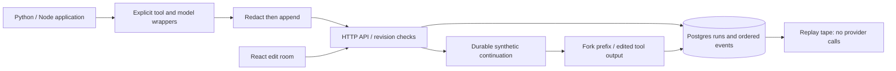

# Stepwise

Nondeterministic agent calls hide failures; Stepwise records their boundaries so you can inspect, replay and fork a synthetic workflow without overwriting its original trace.

## Result

Exact redacted replay: 10 frames across original/repaired runs; 12 tests pass ([raw run](docs/results/gates-and-bench.txt), [hash proofs](docs/results/replay.json)).
Python median call time: disabled 0.125 µs; memory capture 16.958 µs; synchronous HTTP/Postgres 3.058 ms ([samples](docs/results/bench.json)).
Automated fault localization, 1000 events: raw JSONL 1.786 ms vs SQL 2.121 ms median; real UI recording 93.24 s ([browser proof](docs/results/browser/review.json)); human diagnosis time **not measured**.

## Architecture



## Run it

Prerequisites: Python, Node/npm and PostgreSQL server tools on PATH. No model account, database account or dataset download. `make demo` owns a temporary database; set DATABASE_URL only for an explicitly owned persistent database. Existing traces on a supplied database are not cleared.

```sh
make demo
# Open http://127.0.0.1:8091
make lint test bench
```

Alternatively `docker compose up --build`; use the documented synthetic local console token in Connection settings. See [demo and recording steps](docs/DEMO.md), [SDK examples](docs/SDK.md), and the [actual recording](docs/results/browser/demo.webm).

## Decisions and limits

**Partial for the broader spec:** durable breakpoints, edited tool outputs and continuation are implemented for an explicit synthetic workflow. Generic Python/Node application traces support call capture, inspection, diff and application-driven replay; arbitrary application pause/edit/resume is unfinished. Human diagnosis-time improvement, actual model-provider integrations, streaming, multitenant authorization and hosted operation are not measured or implemented. Nothing is deployed.

The model boundary is a nondeterministic scripted synthetic function, not LLM inference. Replay equality means canonical **redacted call payloads** (including failures), excluding timing and run metadata. A configured secret cannot be reconstructed. The demo replay reruns its continuation logic; an uploaded SDK trace must be replayed inside its calling application to verify that application's behavior. The API cannot execute arbitrary uploaded code.

Original traces are immutable through this API; DB owners can still mutate rows. External tool effects and trace commits are not atomic. Synchronous persistence fails closed and has visible cost; neither pooling nor asynchronous buffering conceals that cost. One worker per SDK tape. Per-run/body limits do not bound database growth. See [design](docs/DESIGN.md) and [ADRs](docs/adr/).

The automated SQL lookup did not improve the raw-log baseline in this run. It times a known predicate, not a person discovering a bug or navigating this UI. Node memory samples are separate; Node HTTP overhead is not separately measured. Results are local, small-workload observations, not production forecasts.

Demonstrated caught failures: [divergent replay rejected](docs/results/caught-failure.json), [outdated bundled pip rejected by dependency scan](docs/results/caught-outdated-pip-audit.txt), repaired [clean scan](docs/results/python-audit.txt); tests cover stale revisions, conflicting writes, actual process exit before commit and unavailable Postgres. [Browser proof](docs/results/browser/review.json) exercises real fault/recovery, responsive layouts and keyboard focus. [UI reference and original design](docs/UI_REFERENCES.md).

[Interview walkthrough](INTERVIEW.md) · [Hard follow-ups](DRILL.md) · [Migration provenance](docs/migration/stepwise.md) · [CI](https://github.com/rjrddy/stepwise/actions)

## Next

A cooperative SDK continuation protocol for arbitrary agents; instrument an actual provider through an explicit adapter; streaming/async spans; pooled batched ingest with a documented loss budget; user identities, retention and trace pagination; a counterbalanced human diagnosis study. Integrate with Lean only after it independently passes its checks.
